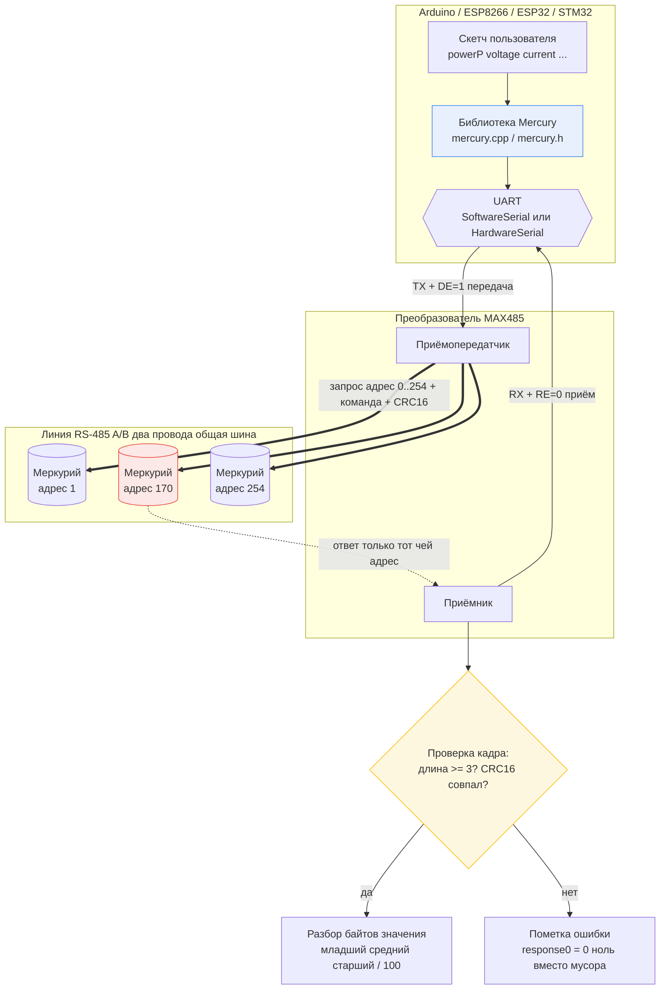
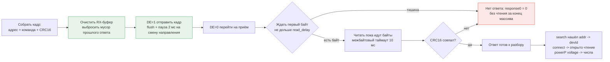
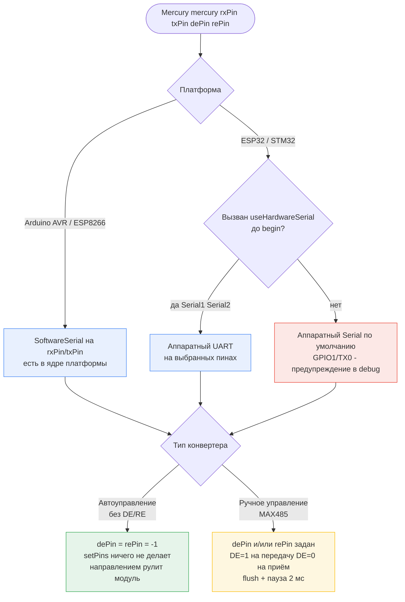

# Mercury Library

Mercury Library — это библиотека для работы с устройствами учёта электроэнергии от компании Инкотекс серии Меркурий, такими как Меркурий 150, 203.2TD, 204, 208, 230, 231, 234, 236, 238, 350. Библиотека поддерживает работу с Arduino, ESP8266, ESP32 и STM32.

## Совместимость

- Arduino (ATmega328 и другие платы с библиотекой SoftwareSerial)
- ESP8266 (SoftwareSerial из ядра или аппаратный UART через `useHardwareSerial`)
- ESP32 (аппаратный UART Serial1/Serial2 — в ядре ESP32 библиотеки SoftwareSerial нет, это учтено условиями компиляции)
- STM32 (через реализацию HardwareSerial платформы; при отсутствии SoftwareSerial используйте `useHardwareSerial`)
- RS-485 конвертеры с автоуправлением направлением (без управляющих линий): оставьте `dePin = rePin = -1`
- RS-485 конвертеры с ручным управлением направлением (MAX485 и аналоги): задайте `dePin` и/или `rePin`

## Возможности и особенности

- Поддержка работы с различными моделями счётчиков Меркурий.
- Возможность работы как с обычными преобразователями MAX485, так и с их версиями/аналогами, которые автоматически переключаются между режимами отправки и приёма.
- Поддержка программного UART (SoftwareSerial) и аппаратного UART (HardwareSerial).
- Возможность включения отладочной информации для удобства разработки.
- Поддержка работы с направлением потока энергии (если включено).

## Описание функций

### Конструктор

```cpp
Mercury(int rxPin, int txPin, int dePin = -1, int rePin = -1, bool enableDirInfo = false, bool debug = false);
```

- `rxPin`: Пин для приёма данных.
- `txPin`: Пин для передачи данных.
- `dePin`: Пин для управления направлением данных (опционально).
- `rePin`: Пин для управления приёмом данных (опционально).
- `enableDirInfo`: Включение информации о направлении потока энергии (опционально).
- `debug`: Включение отладочной информации (опционально).

### Начальная настройка

```cpp
void begin(byte id = 0, long baud_rate = 9600, int read_delay = 150, int send_delay = 2);
```

- `id`: Идентификатор устройства (опционально).
- `baud_rate`: Скорость передачи данных (опционально).
- `read_delay`: Задержка перед чтением данных (опционально).
- `send_delay`: Задержка перед отправкой данных (опционально).

### Поиск устройства

```cpp
void search();
```

### Подключение к устройству

```cpp
void connect(byte level = 1, const char* password = "111111");
```

- `level`: Уровень доступа 1 или 2 (опционально).
- `password`: 6-значный пароль для подключения (опционально).

### Получение данных

#### Активная мощность

```cpp
float* powerP(); // 4 значения, общая по фазам и по каждой фазе
```

#### Реактивная мощность

```cpp
float* powerQ(); // 4 значения, общая по фазам и по каждой фазе
```

#### Полная мощность

```cpp
float* powerS(); // 4 значения, общая по фазам и по каждой фазе
```

#### Напряжение

```cpp
float* voltage(); // 3 значения, 1 фаза, 2 фаза и 3 фаза
```

#### Ток

```cpp
float* current(); // 3 значения, 1 фаза, 2 фаза и 3 фаза
```

#### Коэффициент мощности

```cpp
float* powerFactor(); // 4 значения, общий по фазам и по каждой фазе
```

#### Частота

```cpp
float frequency();
```

#### Температура

```cpp
int temperature();
```

#### Энергия

```cpp
float* energyTaAr(); // 3 значения, 1 фаза, 2 фаза и 3 фаза
float* energyTaF(); // 4 значения, общая по фазам и по каждой фазе
float* energyT1Ar(); // 3 значения, 1 фаза, 2 фаза и 3 фаза
float* energyT1F(); // 4 значения, общая по фазам и по каждой фазе
float* energyT2Ar(); //3 значения, 1 фаза, 2 фаза и 3 фаза
float* energyT2F(); // 4 значения, общая по фазам и по каждой фазе
```

## Тонкости работы с библиотекой

- Для корректной работы с преобразователями MAX485 и их аналогами необходимо правильно настроить пины `dePin` и `rePin`.
- Включение отладочной информации (`debug`) позволяет отслеживать отправляемые и получаемые данные, что упрощает процесс разработки и отладки.
- Включение информации о направлении потока энергии (`enableDirInfo`) позволяет получать дополнительные данные о направлении потока энергии.

## Архитектура проекта

Проект состоит из трёх частей: скетч пользователя, библиотека Mercury и физический уровень RS-485. Ниже схема того, как запрос проходит от Arduino до счётчика и обратно (рисунок на основе Mermaid — GitHub отображает его автоматически).



Жизненный цикл одного запроса внутри `sendCmd()` показан на блок-схеме ниже. Именно здесь раньше терялись ответы счётчика: буфер приёма не чистился, а направление TX/RX переключалось без задержки.



### Выбор конфигурации: платформа и тип RS-485 конвертера

Библиотека подстраивается под две независимые вещи: какой UART даёт платформа и умеет ли конвертер сам переключать направление. На схеме ниже — все поддерживаемые комбинации (условия компиляции `#if !defined(ESP32)` сами выбирают нужный путь).



## Исправленные ошибки (CHANGELOG)

Ниже — что именно было сломано в старом коде и как это выглядит теперь. Формат: **Было** → **Стало**.

### 1. Поиск счётчика: диапазон адресов 1..127 вместо 0..254

Главная причина «код не мог найти счётчик». Меркурий поддерживает адреса **0..254**, а старый `search()` опрашивал только 1..127. Счётчики с адресом 0 (заводской), 170 (0xAA, типовой по ГОСТ), 250 или 254 никогда не отвечали на запросы — поиск завершался впустую, а все последующие команды уходили на прежний `devId`, то есть в пустоту («молчание» на линии).

**Было:**
```cpp
void Mercury::search() {
    byte response[4];
    for (int addr = 1; addr <= 127; addr++) {   // адреса 0 и 128..254 не опрашивались
        ...
    }
}
```

**Стало:**
```cpp
void Mercury::search() {
    byte response[8];
    bool found = false;
    for (int addr = 0; addr <= 254; addr++) {   // полный диапазон Меркурия
        ...
    }
    if (!found && debug) {
        Serial.println("Счётчик не найден в диапазоне 0..254");
    }
}
```

### 2. Пустой ответ читался «за край» массива (undefined behavior)

**Было:** если счётчик промолчал, `responseLength` оставался нулём, а код всё равно брал CRC из `response[-2]` и `response[-1]` — байты из случайной области памяти. На одних платах это случайные «найденные» адреса в `search()`, на других — мусорные показания или зависания.

```cpp
// Было — при отсутствии ответа:
unsigned int receivedCrc = (response[responseLength - 2] | (response[responseLength - 1] << 8)); // response[-2], response[-1]!
```

**Стало:** короткий/пустой ответ сразу помечается как ошибка, CRC не читается из ниоткуда:

```cpp
// Стало:
if (responseLength < 3) {
    if (debug) Serial.println("Нет ответа (таймаут)");
    response[0] = 0;   // признак ошибки для вызывающего кода
    return;
}
```

### 3. RX-буфер не чистился перед запросом («вечные» CRC error)

**Было:** осколок прошлого ответа или эхо собственного запроса оставались в буфере. Новый ответ считывался со смещением на один байт — и после первой же ошибки библиотека уже не могла нормально общаться со счётчиком.

**Стало:** перед каждой отправкой буфер приёма полностью дренируется:

```cpp
// Стало:
while ((softSerial ? softSerial->available() : hardSerial->available()) > 0) {
    (void)(softSerial ? softSerial->read() : hardSerial->read());
}
```

### 4. Переключение TX/RX у MAX485 без flush и паузы

**Было:** `setPins(true); write(...); setPins(false);` — пин DE опускался сразу после записи в регистр UART, последние биты кадра могли обрезаться в эфире, а приёмник включался до того, как трансивер успевал переключиться. Плюс жёсткая пауза `delay(read_delay)` вслепую.

**Стало:**

```cpp
// Стало:
setPins(true);
serial->write(fullCmd, s + 3);
serial->flush();      // дожидаться физической отправки последнего бита
delay(2);             // пауза на смену направления TX -> RX
setPins(false);
// дальше — ожидание первого байта с таймаутом read_delay
// и чтение с межбайтовым таймаутом 10 мс вместо слепого delay
```

### 5. Аппаратный UART был недостижим, а `setPins` игнорировал модули с одним управляющим пином

**Было:** в `begin()` ветка `HardwareSerial` была недостижимым кодом (`softSerial` всегда создавался первым), а `setPins()` работал только когда заданы **оба** пина `dePin` **и** `rePin` — модули, где выведен только DE (или только RE), молчали.

**Стало:** явный выбор порта через `useHardwareSerial(&Serial1)`, корректное освобождение SoftwareSerial при повторном `begin()`, и управление любым из пинов по отдельности:

```cpp
// Стало:
void Mercury::setPins(bool state) {
    if (dePin != -1) digitalWrite(dePin, state);
    if (rePin != -1) digitalWrite(rePin, !state);
}
```

### 6. Разбор энергии: байты значения читались с неправильным сдвигом

**Было:** во всех функциях энергии (`energyTaAr`, `energyT1F` и др.) средний байт числа брался как `response[4 + i * 4]` — на байт правее реального, показания выходили искажёнными.

```cpp
// Было:
unsigned long value = (response[3 + i * 4] & 0x3F) | (response[4 + i * 4] << 8) | (response[1 + i * 4] << 16);
```

**Стало:** побайтно, как в остальных функциях библиотеки (младший → средний → старший):

```cpp
// Стало:
unsigned long value = (response[3 + i * 4] & 0x3F) | (response[2 + i * 4] << 8) | (response[1 + i * 4] << 16);
```

### 7. Буфер ответа `voltage()` размером 4 байта при реальном кадре длиннее

**Было:** `byte response[4]` — ответ на запрос напряжения длиннее четырёх байт, запись шла поверх стека (переполнение буфера).

**Стало:** `byte response[16]` + проверка `response[0] == 0` перед разбором.

### 8. `connect()` принимал мусор за успешное подключение

**Было:** успех определялся только по `response[1] == 0x00`, что совпадало и при битом кадре.

**Стало:** проверяется и эхо адреса: `if (response[0] == devId && response[1] == 0x00)`.

### 9. Библиотека не собиралась на ESP32 (жёсткая зависимость от SoftwareSerial)

**Было:** `#include <SoftwareSerial.h>` был unconditional, а в ядре ESP32 такой библиотеки нет — любая сборка под ESP32 падала ещё до начала работы:

```cpp
#include <Arduino.h>
#include <SoftwareSerial.h>   // fatal error: No such file or directory (ESP32)
```

**Стало:** подключение и использование программного UART закрыто условием компиляции — на Arduino/ESP8266 работает SoftwareSerial, на ESP32 автоматически остаётся только аппаратный UART:

```cpp
#if !defined(ESP32)
#define MERCURY_HAS_SOFTWARE_SERIAL 1
#include <SoftwareSerial.h>
#else
#define MERCURY_HAS_SOFTWARE_SERIAL 0
#endif
```

Все обращения к порту сведены к макросам `MERC_PORT_AVAILABLE()` / `MERC_PORT_READ()`, которые на ESP32 разворачиваются напрямую в `hardSerial->...`. Проверено реальной сборкой: UNO, NodeMCUv2 (ESP8266) и ESP32 компилируются без ошибок.

## Примеры использования методов

### Пример использования без флагов

```cpp
#include <mercury.h>

// Пины для программного UART
#define SSerialRx D1
#define SSerialTx D2

// Создание объекта Mercury с использованием программного UART
Mercury mercury(SSerialRx, SSerialTx, -1, -1, false, true);

void setup() {
    Serial.begin(9600);
    mercury.begin(0, 9600, 150, 2);
    mercury.search();
    mercury.connect(1, "111111");
}

void loop() {
    float* powerP = mercury.powerP();
    Serial.print("Active Power: ");
    for (int i = 0; i < 4; i++) {
        Serial.print(powerP[i]);
        Serial.print(" ");
    }
    Serial.println();

    float* voltage = mercury.voltage();
    Serial.print("Voltage: ");
    for (int i = 0; i < 3; i++) {
        Serial.print(voltage[i]);
        Serial.print(" ");
    }
    Serial.println();

    float* current = mercury.current();
    Serial.print("Current: ");
    for (int i = 0; i < 3; i++) {
        Serial.print(current[i]);
        Serial.print(" ");
    }
    Serial.println();

    float frequency = mercury.frequency();
    Serial.print("Frequency: ");
    Serial.println(frequency);

    int temperature = mercury.temperature();
    Serial.print("Temperature: ");
    Serial.println(temperature);

    delay(2000);
}
```

### Пример использования с флагами

```cpp
#include <mercury.h>

// Пины для программного UART
#define SSerialRx D1
#define SSerialTx D2

// Создание объекта Mercury с использованием программного UART
Mercury mercury(SSerialRx, SSerialTx, -1, -1, true, true);

void setup() {
    Serial.begin(9600);
    mercury.begin(0, 9600, 150, 2);
    mercury.search();
    mercury.connect(1, "111111");
}

void loop() {
    float* powerP = mercury.powerP();
    Serial.print("Active Power: ");
    for (int i = 0; i < 4; i++) {
        Serial.print(powerP[i]);
        Serial.print(" ");
    }
    Serial.println();

    float* voltage = mercury.voltage();
    Serial.print("Voltage: ");
    for (int i = 0; i < 3; i++) {
        Serial.print(voltage[i]);
        Serial.print(" ");
    }
    Serial.println();

    float* current = mercury.current();
    Serial.print("Current: ");
    for (int i = 0; i < 3; i++) {
        Serial.print(current[i]);
        Serial.print(" ");
    }
    Serial.println();

    float frequency = mercury.frequency();
    Serial.print("Frequency: ");
    Serial.println(frequency);

    int temperature = mercury.temperature();
    Serial.print("Temperature: ");
    Serial.println(temperature);

    delay(2000);
}
```

## Заключение

Mercury Library предоставляет удобный интерфейс для работы с устройствами учёта электроэнергии серии Меркурий. Библиотека поддерживает различные платформы и предоставляет широкий набор функций для получения данных с счётчиков.
